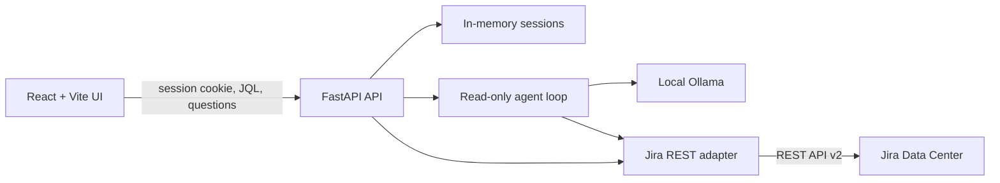

# AIM Jira Assistant

AIM Jira Assistant is a local, read-only Jira workspace for the AIM team. It queries Jira at runtime, displays the current results, and can translate natural-language questions into JQL with a local Ollama model.

Phase 1 deliberately has no Vertica, CSV export, synchronization job, database, Jira writes, or MCP integration. Jira remains the source of truth.

## What you can do

- Connect to Jira Data Center with your personal access token (PAT).
- Ask questions such as “Show AIM major issues waiting for assignment and summarize their status.”
- See and edit the exact JQL produced by the agent.
- Run JQL manually, even without Ollama.
- Page through live results and inspect issue fields and comments.
- Follow issue links back to Jira.

The application cannot create, edit, transition, comment on, or delete Jira issues.

## Architecture at a glance



There are two execution paths:

1. **Manual JQL:** the browser sends JQL to FastAPI, which obtains the PAT from the in-memory session and calls Jira directly.
2. **Ask Jira:** Ollama selects a read-only tool and proposes JQL. The backend adds the configured team restriction, executes it through the same Jira client, and asks Ollama to summarize the evidence.

Ollama never receives the PAT. The browser receives an opaque session cookie, not the PAT after connection.

### Request flows

**Connect**

```text
Browser PAT -> POST /api/session/connect -> Jira /myself validation
            -> PAT stored in backend memory -> opaque HttpOnly cookie returned
```

**Search**

```text
Browser JQL -> session lookup -> JiraClient.search -> Jira REST v2
            -> normalized issues -> browser table
```

**Ask Jira**

```text
Question -> AgentService -> Ollama tool decision -> mandatory team JQL scope
         -> JiraClient -> live issues -> Ollama summary + evidence + exact JQL
```

**Issue detail**

```text
Issue click -> JiraClient.get_issue + comments -> detail panel
```

## Module map

The active Phase 1 application is separated from tests and configuration:

```text
qa-report/
├── backend/              FastAPI, Jira adapter, sessions, and agent runtime
├── frontend/             React/Vite browser application
├── tests/                Backend unit and API tests
├── teams.yaml            Team identity and mandatory Jira filter
├── .env.example          Safe configuration template
├── Makefile              Setup, development, build, and test commands
└── README.md              Architecture and operating instructions
```

| Module | Responsibility |
| --- | --- |
| `backend/server.py` | FastAPI composition, routes, cookies, and static UI serving |
| `backend/config.py` | Environment configuration |
| `backend/sessions.py` | Expiring, in-memory PAT sessions |
| `backend/jira_client.py` | Jira authentication, REST calls, errors, and response normalization |
| `backend/agent.py` | Controlled Ollama tool loop and mandatory team scoping |
| `backend/teams.py` | Current YAML team configuration loader |
| `backend/models.py` | API request and response models |
| `frontend/src/App.jsx` | Current Phase 1 UI and browser workflow |
| `teams.yaml` | Team-to-Jira filter mappings |
| `tests/` | Jira adapter, agent scoping, and API tests with fake services |

`JiraClient` concentrates Jira HTTP and response-normalization details, while `SessionStore` owns PAT expiry and lookup. The current agent runtime and team scope are still Phase 1 seams: AIM knowledge is spread across YAML, backend logic, prompts, and UI defaults, and is a candidate for consolidation after the live mapping is verified.

The backend uses Python namespace-package imports, so it does not need an `__init__.py` file.

## Security rules

- The PAT exists only in the connection request and backend process memory.
- The PAT is not written to `.env`, local storage, logs, Ollama prompts, or API responses.
- The session cookie is `HttpOnly` and contains only a random session identifier.
- Sessions expire after `SESSION_TTL_SECONDS` and are lost when the backend restarts.
- Jira operations are read-only by construction; no write endpoints or agent tools exist.
- Run the Phase 1 server on localhost. It is not hardened for public deployment.

## Prerequisites

- Python 3.11 or newer
- Node.js 20 or newer and npm
- [Ollama](https://ollama.com/download) for natural-language questions
- RADCOM network or VPN access to Jira
- A personal Jira Data Center PAT

Ollama is optional for manual JQL. A PAT is not needed to install, build, or run automated tests.

## Install from a clean clone

From the repository root:

```bash
make setup
```

This creates `.venv`, installs Python and npm dependencies, and copies `.env.example` to `.env` if `.env` does not already exist.

Start Ollama in one terminal:

```bash
ollama serve
```

Pull the configured model once:

```bash
make ollama-pull
```

Start the backend and development UI in another terminal:

```bash
make dev
```

Open <http://localhost:5173>. FastAPI documentation is at <http://127.0.0.1:8000/docs>.

If Ollama is missing or stopped, `make dev` prints a warning. The connection screen and manual JQL still work; **Ask Jira** does not.

## Use the application

1. Connect to the RADCOM VPN or network.
2. Open the UI and paste your Jira PAT into the connection form.
3. AIM is the active configured team in Phase 1; there is no team selector yet.
4. Use **Ask Jira** for a natural-language question, or enter JQL in the search area.
5. Review the exact JQL and returned issues. Click an issue for fields and comments.
6. Disconnect when finished. Restarting the backend also clears all sessions.

Do not put a real PAT in this repository, `.env`, screenshots, chat messages, or test fixtures.

## Useful commands

```bash
make help          # list commands
make setup         # install backend and frontend dependencies
make ollama-pull   # download the configured local model
make dev           # FastAPI with reload + Vite development server
make api           # backend only on port 8000
make ui            # frontend only on port 5173
make test          # backend tests + production frontend build
make serve         # build UI and serve everything on port 8000
```

`make serve` is a local single-process preview, not a production deployment recipe.

## Configuration

`make setup` creates `.env` from `.env.example`. For the current RADCOM Phase 1 setup, you normally only need to confirm `JIRA_BASE_URL`; the PAT is entered in the connection screen and must not be added to `.env`.

Start with:

```dotenv
JIRA_BASE_URL=https://jira-prod.radcom.co.il:8443
JIRA_VERIFY_SSL=false
OLLAMA_URL=http://127.0.0.1:11434
OLLAMA_MODEL=qwen3.5:4b
TEAMS_CONFIG=teams.yaml
```

What to change:

- `JIRA_BASE_URL`: change this only if your Jira instance has another address.
- `JIRA_VERIFY_SSL`: use `true` when the machine trusts the Jira certificate. The current internal prototype uses `false`; do not use that setting for a public deployment.
- `OLLAMA_URL`: leave unchanged when Ollama runs on the same laptop.
- `OLLAMA_MODEL`: leave unchanged after running `make ollama-pull`, or replace it with another locally installed tool-capable model.
- `TEAMS_CONFIG`: leave as `teams.yaml` unless team configuration is moved elsewhere.
- `COOKIE_SECURE`: keep `false` for localhost HTTP. Set it to `true` only when serving through HTTPS.
- `CORS_ORIGINS`: add the exact frontend origin only when it is not running on the default Vite address.

You do **not** put these in `.env`:

- Jira PAT: paste it into the UI when connecting.
- Jira username or password: the app does not use them.
- Ollama API key: local Ollama does not require one.

| Variable | Default purpose |
| --- | --- |
| `JIRA_BASE_URL` | RADCOM Jira Data Center base URL |
| `JIRA_VERIFY_SSL` | Whether to verify the Jira TLS certificate |
| `JIRA_TIMEOUT_SECONDS` | Timeout for Jira HTTP requests |
| `OLLAMA_URL` | Local Ollama HTTP endpoint |
| `OLLAMA_MODEL` | Tool-capable local model, currently `qwen3.5:4b` |
| `TEAMS_CONFIG` | Path to team definitions, relative to the repository root |
| `SESSION_TTL_SECONDS` | In-memory login lifetime, currently eight hours |
| `AGENT_MAX_TOOL_CALLS` | Maximum Jira lookups during one agent request |
| `AGENT_SUMMARY_ISSUE_LIMIT` | Maximum issues passed to Ollama for summarization |
| `COOKIE_SECURE` | Require HTTPS when sending the session cookie |
| `CORS_ORIGINS` | Comma-separated browser origins allowed to call the API |
| `SERVE_UI` | Serve the built frontend from FastAPI when `true`; set by `make serve` |

Teams are configured in `teams.yaml`:

```yaml
teams:
  AIM:
    jira_filter: 'project = AIM'
    verified: true
```

This filter is the mandatory boundary added to every agent-generated query. It is not authentication and it does not contain the PAT. The PAT is created from Jira Profile → Personal access tokens and pasted into the application connection screen.

At backend startup, `backend/teams.py` reads this file and creates the AIM configuration. When Ollama proposes JQL such as `priority = Major`, `backend/agent.py` combines it with the configured filter before calling Jira:

```jql
(project = AIM) AND (priority = Major)
```

Restart `make dev` after changing `teams.yaml`. Phase 1 contains only AIM; a future team would require another entry with its own project filter, such as `project = NAM`.

## API surface

| Method | Path | Purpose |
| --- | --- | --- |
| `GET` | `/api/health` | Service configuration and availability |
| `POST` | `/api/session/connect` | Validate PAT and create an in-memory session |
| `GET` | `/api/session` | Read current session identity |
| `DELETE` | `/api/session` | Remove the current session |
| `GET` | `/api/teams` | List configured teams |
| `GET` | `/api/jira/fields` | Read Jira field metadata |
| `POST` | `/api/jira/search` | Execute read-only JQL |
| `GET` | `/api/jira/issues/{issue_key}` | Read an issue and its comments |
| `POST` | `/api/agent/chat` | Run the bounded read-only agent loop |

## Test

```bash
make test
```

The backend tests use `httpx.MockTransport` and fake Jira clients, so they do not contact Jira or require secrets. The frontend check creates a production Vite build.

## Troubleshooting

### Observe a live request

Keep the `make dev` terminal visible while using the UI. The backend logs each external boundary without logging the PAT or issue contents:

```text
[AIM] Jira authentication succeeded: user=...
[AIM] Agent request started: team=AIM
[AIM] Ollama request started: model=qwen3.5:4b tools=True
[AIM] Ollama selected Jira search: jql=(project = AIM) AND (...)
[AIM] Jira API response received: POST /rest/api/2/search status=200 elapsed=...
[AIM] Jira evidence returned to Ollama: total=...
[AIM] Agent request completed: total=...
```

Reaching the workspace proves `/rest/api/2/myself` accepted the PAT. To verify Jira search independently of Ollama, open **JQL Search** and run `project = AIM ORDER BY updated DESC`; a result table and a `status=200` search log prove live Jira access.

**Connection fails or times out**

- Confirm VPN/internal network access and `JIRA_BASE_URL`.
- Open Jira in a browser from the same laptop.
- A `401` or `403` usually means the PAT is invalid, expired, or lacks access.

**TLS/certificate error**

- Use the organization certificate chain when available.
- `JIRA_VERIFY_SSL=false` is acceptable only for this local internal prototype; do not carry it into a public deployment.

**Ask Jira is unavailable**

- Run `ollama serve`.
- Run `make ollama-pull` and confirm the model name matches `.env`.
- Manual JQL remains available.

**AIM results are empty or wrong**

- Treat this first as a team-mapping problem, not an AI problem.
- Inspect Jira field metadata through `/api/jira/fields` and verify the filter in Jira's own advanced search.
- Update `teams.yaml` only after confirming the actual field/value pair.

**Port already in use**

- Stop the process using port `8000` or `5173`, then run `make dev` again.

## Current limits

- One unverified AIM team mapping
- Single-process, in-memory sessions
- No shared session store or multi-instance support
- No persistence, history, analytics warehouse, or offline cache
- No Jira write actions
- No MCP or Dify dependency
- Bounded result sets and agent tool calls
- No frontend unit or end-to-end test suite yet

These are deliberate Phase 1 boundaries, not the intended final platform architecture.

## Next action items

1. **Live-validate the complete flow.** Verify PAT login, representative AIM JQL, comments, custom fields, and Jira links on the RADCOM network.
2. **Consolidate AIM scope.** Make AIM identity, aliases, default queries, and mandatory JQL restriction one backend-owned module.
3. **Add regression coverage.** Cover session expiry, Jira error translation, malformed Ollama tool calls, AIM-scope bypass attempts, and the main browser workflows.
4. **Harden only when usage requires it.** Then consider a shared session store, multiple app instances, organization authentication, audited write approvals, or hybrid synchronization.
