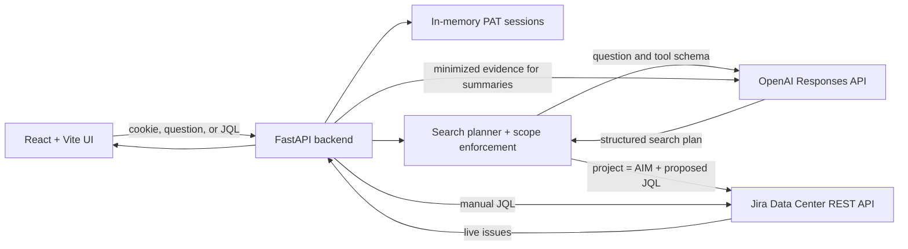

# AIM Jira Assistant

AIM Jira Assistant is a local, read-only Jira workspace for RADCOM's AIM project. It queries Jira at runtime, resolves people through Jira, and uses OpenAI to plan searches and produce grounded summaries.

Phase 1 has no database, Vertica, synchronization job, Jira writes, MCP, or Dify. Jira remains the source of truth.

## What it does

- Connects to Jira Data Center with the user's personal access token (PAT).
- Answers questions such as “Show major AIM issues waiting for assignment.”
- Shows the exact generated JQL and live Jira results.
- Runs manually written JQL without using OpenAI.
- Displays issue fields, comments, and links back to Jira.
- Resolves names against AIM-assignable Jira users instead of guessing.
- Summarizes live issue sets and renders status, priority, assignee, or type charts.

The application cannot create, edit, transition, comment on, or delete Jira issues.

## Architecture



There are two paths:

1. **Manual JQL:** FastAPI retrieves the PAT from the in-memory session and calls Jira directly.
2. **Ask Jira:** OpenAI creates a structured plan. Named people are resolved through Jira's assignable-user search, the backend always adds `project = AIM`, and Jira returns the live issues. List requests return directly; summary and visualization requests make a second grounded OpenAI call.

OpenAI never receives the Jira PAT. For summaries and visualizations it receives minimized issue evidence: keys, summaries, status, priority, assignee, type, and dates. A one-issue summary can also include its description, labels, and components; comments and arbitrary custom fields are excluded. Recent conversation text is used for follow-up planning. Use this only under RADCOM's approved data policy.

## Repository map

```text
qa-report/
├── backend/              FastAPI, Jira client, sessions, JQL translation
├── frontend/             React/Vite browser application
├── tests/                Backend unit and API tests
├── teams.yaml            Mandatory AIM project mapping
├── .env.example          Safe environment template
├── Makefile              Setup, run, build, and test commands
└── README.md
```

| Module | Responsibility |
| --- | --- |
| `backend/server.py` | Routes, composition, cookies, and static UI serving |
| `backend/config.py` | Environment configuration |
| `backend/sessions.py` | Expiring in-memory PAT sessions |
| `backend/jira_client.py` | Jira REST calls and response normalization |
| `backend/agent.py` | Search planning, Jira user resolution, grounded summaries, charts, and AIM scoping |
| `backend/teams.py` | YAML team configuration loader |
| `backend/models.py` | API request and response models |
| `frontend/src/App.jsx` | Phase 1 UI and browser workflow |

Python namespace-package imports are used, so `__init__.py` files are not required.

## Security model

- The Jira PAT is pasted into the UI and held only in backend process memory.
- The OpenAI API key is read by the backend from `.env`; it is never sent to the browser.
- Neither key is logged or returned by an API response.
- The browser receives an opaque `HttpOnly` session cookie.
- Sessions expire and disappear when the backend restarts.
- Only read-only Jira operations and agent tools exist.
- Phase 1 should run on localhost; it is not hardened for public deployment.

## Setup and run

Prerequisites: Python 3.11+, Node.js 20+, npm, RADCOM network/VPN access, a Jira PAT, and an OpenAI API key approved for organization use.

From the repository root:

```bash
make setup
```

This creates `.venv`, installs dependencies, and creates `.env` from `.env.example` only when `.env` does not already exist.

Open `.env` and set your OpenAI API key:

```dotenv
OPENAI_API_KEY=your_key_here
OPENAI_MODEL=gpt-6-luna
```

Do not paste the key into the UI, a chat, a screenshot, source code, or Git. `.env` is intentionally ignored by Git.

Start both services:

```bash
make dev
```

Open <http://localhost:5173>. FastAPI documentation is at <http://127.0.0.1:8000/docs>.

Press `Ctrl+C` once in the `make dev` terminal to stop both frontend and backend. After changing `.env`, stop and restart `make dev` because environment values are loaded at backend startup.

## Using the application

1. Connect to the RADCOM network or VPN.
2. Open the UI and paste the Jira PAT into the Jira connection form.
3. Ask a question in **Ask Jira**, for example: `Show Major AIM issues assigned to yuvraj`, `Summarize the current AIM sprint`, or `Visualize the current AIM sprint by status`.
4. Inspect the exact JQL and the returned live issues.
5. Use **JQL Search** when you want direct control and no OpenAI call.

AIM is fixed for Phase 1. `teams.yaml` contains:

```yaml
teams:
  AIM:
    jira_filter: 'project = AIM'
    verified: true
```

If OpenAI proposes `priority = Major AND assignee is EMPTY`, the backend executes:

```jql
(project = AIM) AND (priority = Major AND assignee is EMPTY)
```

This mandatory backend scope is the protection; the model cannot remove it.

## Configuration

| Variable | Purpose |
| --- | --- |
| `OPENAI_API_KEY` | Server-side OpenAI API credential required by Ask Jira |
| `OPENAI_MODEL` | Model used to translate questions into JQL |
| `OPENAI_BASE_URL` | OpenAI API base URL; normally `https://api.openai.com/v1` |
| `OPENAI_TIMEOUT_SECONDS` | Timeout for OpenAI requests |
| `JIRA_BASE_URL` | RADCOM Jira Data Center base URL |
| `JIRA_VERIFY_SSL` | Whether to verify Jira's TLS certificate |
| `JIRA_TIMEOUT_SECONDS` | Timeout for Jira HTTP requests |
| `TEAMS_CONFIG` | Team definition path relative to the repository root |
| `SESSION_TTL_SECONDS` | In-memory Jira login lifetime |
| `COOKIE_SECURE` | Require HTTPS for the session cookie |
| `CORS_ORIGINS` | Browser origins allowed to call the API |

The Jira PAT does not belong in `.env`; enter it in the application. The OpenAI API key does belong in `.env`; it is an application credential, not a Jira credential.

## Useful commands

```bash
make help          # list commands
make setup         # install dependencies and create .env when absent
make dev           # run backend and frontend
make api           # backend only on port 8000
make ui            # frontend only on port 5173
make test          # backend tests and production frontend build
make serve         # build and serve the complete app on port 8000
```

`make serve` is a local preview, not a production deployment recipe.

## API surface

| Method | Path | Purpose |
| --- | --- | --- |
| `GET` | `/api/health` | Safe provider/configuration status |
| `POST` | `/api/session/connect` | Validate Jira PAT and create a session |
| `GET` | `/api/session` | Read current session identity |
| `DELETE` | `/api/session` | Remove the current session |
| `GET` | `/api/teams` | List configured teams |
| `GET` | `/api/jira/fields` | Read Jira field metadata |
| `POST` | `/api/jira/search` | Execute read-only JQL |
| `GET` | `/api/jira/issues/{issue_key}` | Read an issue and comments |
| `POST` | `/api/agent/chat` | Translate a question and run one scoped Jira search |

## Verify and troubleshoot

Run automated checks:

```bash
make test
```

Check safe runtime configuration:

```bash
curl http://127.0.0.1:8000/api/health
```

`openai_configured` should be `true`. The endpoint never returns the key.

Keep the `make dev` terminal visible during a request. A successful flow looks like:

```text
[AIM] Agent request started: team=AIM
[AIM] OpenAI request started: model=...
[AIM] OpenAI response received: status=200 elapsed=...
[AIM] Agent selected Jira search: jql=(project = AIM) AND (...)
[AIM] Jira API response received: POST /rest/api/2/search status=200 elapsed=...
[AIM] Jira search completed locally: total=...
```

Reaching the workspace proves Jira accepted the PAT through `/rest/api/2/myself`. Running `project = AIM ORDER BY updated DESC` in **JQL Search** verifies Jira independently of OpenAI.

**OpenAI error**

- `401`: confirm `OPENAI_API_KEY` in `.env`, then restart `make dev`.
- `429`: check the API project's billing, credits, and rate limits. A ChatGPT subscription alone does not automatically provide API quota.
- Model unavailable: set `OPENAI_MODEL` to a model enabled for that API project.
- Manual JQL remains available while OpenAI is unavailable.

**Jira error**

- Confirm VPN/network access and `JIRA_BASE_URL`.
- `401` or `403` normally means the Jira PAT is invalid, expired, or lacks access.
- Keep `JIRA_VERIFY_SSL=false` only for this local internal prototype; use the organization certificate chain for a deployed service.

**Port already in use**

Stop the previous `make dev` terminal with `Ctrl+C`. If a previously crashed process remains, identify it with `ss -ltnp | grep -E ':8000|:5173'` and stop that specific process.

## Next action items

1. Validate representative questions against live AIM data and save expected question-to-JQL cases as tests.
2. Confirm RADCOM policy permits sending the current question and minimized Jira evidence to the chosen OpenAI organization/project.
3. Add browser end-to-end tests for Jira login, Ask Jira, manual JQL, and disconnect.
4. Add organization authentication, audit events, and a shared secret/session store before any multi-user deployment.
5. Add teams only after AIM is reliable; keep each project scope enforced by backend configuration.
